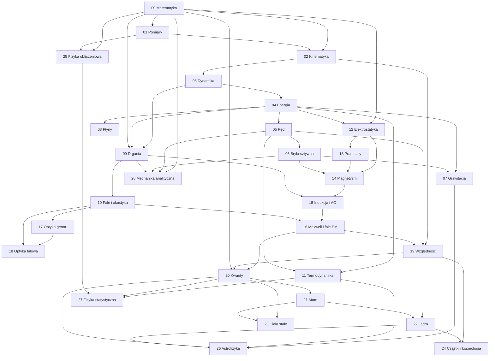

# Roadmapa — kolejność, zależności i czas

## Graf zależności

Strzałka oznacza „warto znać przed”. Moduły bez strzałek między sobą można przerabiać równolegle.

## Trzy ścieżki nauki

### Ścieżka A — matura rozszerzona 🟢

Tylko tematy oznaczone 🟢 i 🟢🔵 (w tych drugich pomijasz wersję z rachunkiem i zadania B). Układ odpowiada typowemu rozkładowi materiału w liceum w zakresie rozszerzonym.

| Etap | Moduły | Uwagi |
|---|---|---|
| Klasa 1 | 01 Pomiary, 02 Kinematyka, 03 Dynamika, 04 Energia, 05 Pęd, 08 Płyny (hydrostatyka) | Niepewności pomiarowe od pierwszego dnia |
| Klasa 2 | 06 Bryła sztywna, 07 Grawitacja i astronomia, 09 Drgania, 11 Termodynamika, 12 Elektrostatyka | |
| Klasa 3 | 13 Prąd stały, 14 Magnetyzm, 15 Indukcja, 10 Fale i akustyka, 17 Optyka geometryczna, 18 Optyka falowa | |
| Klasa 4 | 20 Kwanty, 21 Atom, 19 Względność, 22 Jądro, powtórka całości; dla chętnych 26.01 i 26.03 (gwiazdy, wymaganie fakultatywne) | Arkusze CKE: [zadania przypisane do tematów](matura/README.md), [wymagania](matura/wymagania.md), [karta wzorów](matura/karta-wzorow.md) |

### Ścieżka B — fizyka na politechnice 🔵

Wszystkie tematy, łącznie z wersjami z rachunkiem i zadaniami B. Odpowiada typowemu podziałowi kursu fizyki na studiach technicznych (nazwy i liczba semestrów różnią się między uczelniami).

| Semestr | Moduły | Uwagi |
|---|---|---|
| Fizyka I | 00 Matematyka, 01 Pomiary, 02–08 Mechanika, 09 Drgania, 10 Fale, 11 Termodynamika, 25 Fizyka obliczeniowa (część 1) | Całki i proste równania różniczkowe muszą być „w palcach” |
| Fizyka II | 12–16 Elektromagnetyzm, 17–18 Optyka | Prawo Gaussa i Ampère'a wymagają całek po powierzchni i krzywej |
| Fizyka III / współczesna | 19 Względność, 20 Kwanty, 21 Atom, 22 Jądro, 23 Ciało stałe, 24 Cząstki i kosmologia, 25 (część 2) | Na wielu kierunkach skrócona do wybranych tematów |
| Rozszerzenia (2. rok) | 26 Astrofizyka, 27 Fizyka statystyczna, 28 Mechanika analityczna | Wstęp do przedmiotów drugiego roku fizyki: mechaniki teoretycznej, fizyki statystycznej i astrofizyki |

### Ścieżka C — most: po maturze, przed politechniką 🟢 → 🔵

Dla osoby, która zna fizykę maturalną i chce wejść na studia przygotowana.

1. Moduł **00** w całości (pochodne, całki, proste równania różniczkowe).
2. Tematy 🟢🔵 z modułów 02–15 — tylko sekcje „Wersja z rachunkiem” i zadania B.
3. Tematy 🔵 z mechaniki i elektromagnetyzmu: zmienne przyspieszenie, opór ośrodka, środek masy i moment bezwładności liczone całką, drgania tłumione, prawo Gaussa, obwody RC.
4. Moduł **25** — symulacja ruchu w Pythonie jako sprawdzian, że rozumiesz równania ruchu.

## Szacowany nakład pracy

Szacunki dla osoby uczącej się od zera na poziomie 🔵. Ścieżka A (tylko matura) to zwykle około 50–60% tego czasu, odświeżanie wiedzy po studiach — 40–60%.

| Moduł | Od zera [h] | Odświeżenie [h] |
|---|---|---|
| 00 Narzędzia matematyczne fizyka | 40–70 | 16–42 |
| 01 Pomiar, jednostki i niepewności | 20–35 | 8–21 |
| 02 Kinematyka | 30–50 | 12–30 |
| 03 Dynamika punktu materialnego | 35–60 | 14–36 |
| 04 Praca, energia i moc | 25–40 | 10–24 |
| 05 Pęd, środek masy i zderzenia | 25–40 | 10–24 |
| 06 Bryła sztywna, statyka i sprężystość | 35–55 | 14–33 |
| 07 Grawitacja i elementy astronomii | 25–40 | 10–24 |
| 08 Mechanika płynów | 15–25 | 6–15 |
| 09 Drgania | 25–40 | 10–24 |
| 10 Fale mechaniczne i akustyka | 25–40 | 10–24 |
| 11 Termodynamika i teoria kinetyczna | 35–55 | 14–33 |
| 12 Elektrostatyka | 35–55 | 14–33 |
| 13 Prąd stały | 25–40 | 10–24 |
| 14 Pole magnetyczne | 30–50 | 12–30 |
| 15 Indukcja elektromagnetyczna i prąd przemienny | 30–50 | 12–30 |
| 16 Równania Maxwella i fale elektromagnetyczne | 15–25 | 6–15 |
| 17 Optyka geometryczna | 20–35 | 8–21 |
| 18 Optyka falowa | 20–35 | 8–21 |
| 19 Szczególna teoria względności | 15–25 | 6–15 |
| 20 Podstawy fizyki kwantowej | 30–50 | 12–30 |
| 21 Fizyka atomowa | 20–35 | 8–21 |
| 22 Fizyka jądrowa | 20–35 | 8–21 |
| 23 Fizyka ciała stałego | 20–35 | 8–21 |
| 24 Cząstki elementarne i kosmologia | 15–25 | 6–15 |
| 25 Fizyka obliczeniowa w Pythonie | 30–50 | 12–30 |
| 26 Astrofizyka | 20–35 | 8–21 |
| 27 Fizyka statystyczna | 20–35 | 8–21 |
| 28 Mechanika analityczna (wstęp) | 20–35 | 8–21 |
| **Razem** | **~720–1200** | **~288–720** |

## Przykładowy rytm tygodnia (10–12 h, 4 sesje)

| Sesja | Czas | Zawartość |
|---|---|---|
| 1. Teoria i wyprowadzenia | 3 h | Notatki z tematu, rozdział z OpenStax, własna ściąga wzorów z założeniami |
| 2. Zadania | 4 h | Zadania A, potem B; analiza błędów w dzienniku |
| 3. Doświadczenie / symulacja | 2–3 h | Pomiar phyphox lub PhET, opracowanie z niepewnościami, krótki program w Pythonie |
| 4. Test i powtórka | 2 h | Zadania bez notatek, jedno zadanie z wcześniejszego modułu, plan na kolejny tydzień |

Dla 5–6 h tygodniowo: połącz sesje 1+2, doświadczenie rób co dwa tygodnie.

## Kamienie milowe

- [ ] Liczę pochodne i całki potrzebne w mechanice, rozwiązuję równanie $\dot{x} = -kx$ i równanie oscylatora (00).
- [ ] Podaję wynik pomiaru z niepewnością i dopasowuję prostą do danych (01).
- [ ] Rozwiązuję zadania z mechaniki punktu trzema metodami: siły, energia, pęd — i wybieram najprostszą (02–05).
- [ ] Liczę moment bezwładności całką i rozwiązuję zadania z toczeniem i zachowaniem momentu pędu (06).
- [ ] Opisuję ruch po orbicie i wyprowadzam prędkości kosmiczne (07).
- [ ] Rozwiązuję równanie oscylatora tłumionego i wymuszonego, rozumiem rezonans (09).
- [ ] Analizuję cykl termodynamiczny: praca, ciepło, sprawność, zmiana entropii (11).
- [ ] Stosuję prawo Gaussa i Ampère'a do układów o symetrii (12, 14).
- [ ] Opisuję obwody RC, RL, LC i prąd przemienny (13, 15).
- [ ] Wyprowadzam falę EM z równań Maxwella (16).
- [ ] Liczę obrazy w układach optycznych i widma interferencyjne (17–18).
- [ ] Rozwiązuję zadania z dylatacji czasu, energii relatywistycznej, fotoefektu i rozpadu promieniotwórczego (19–22).
- [ ] Symuluję numerycznie ruch, którego nie da się policzyć analitycznie (25).
- [ ] Odczytuję z promieniowania gwiazd ich temperaturę, moc i promień, opisuję ewolucję gwiazd i metody wykrywania egzoplanet (26).
- [ ] Wyprowadzam entropię, rozkład Boltzmanna i ciepło właściwe z liczenia stanów; symuluję przejście fazowe (27).
- [ ] Wyprowadzam równania ruchu z lagranżjanu, znajduję wielkości zachowane i mody normalne (28).
